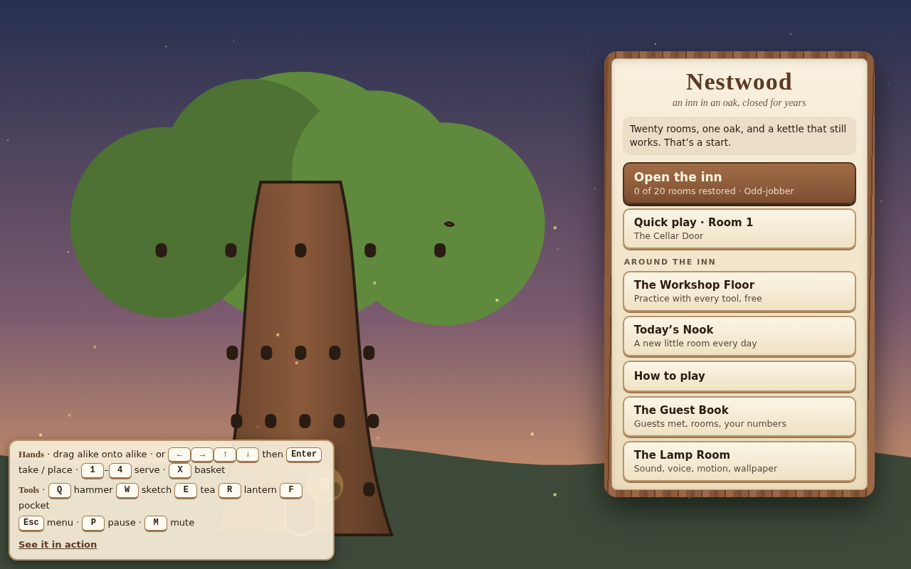
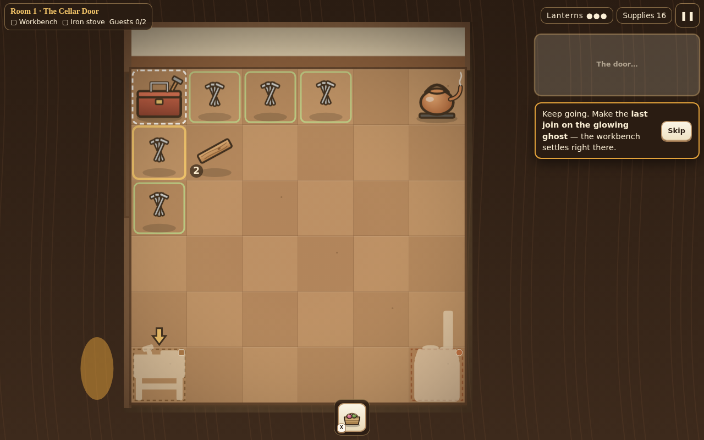
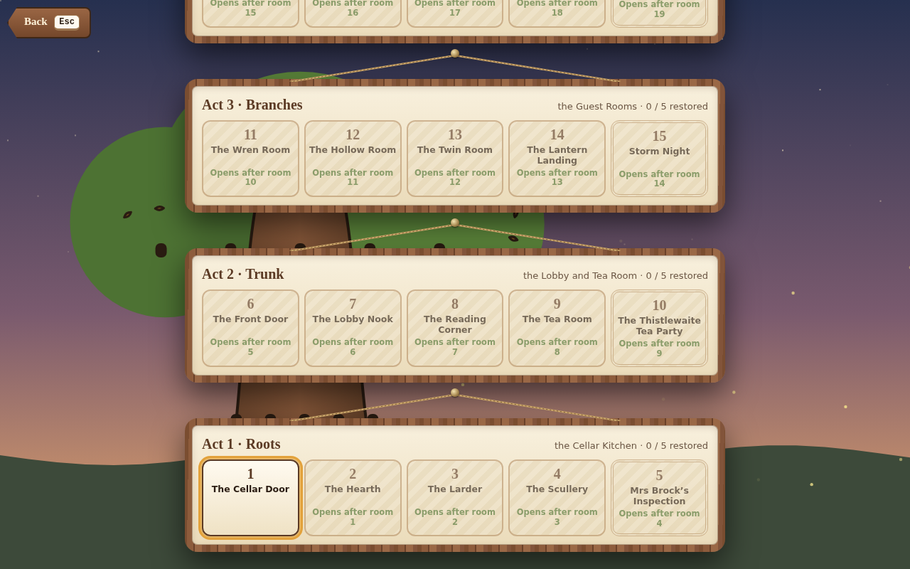
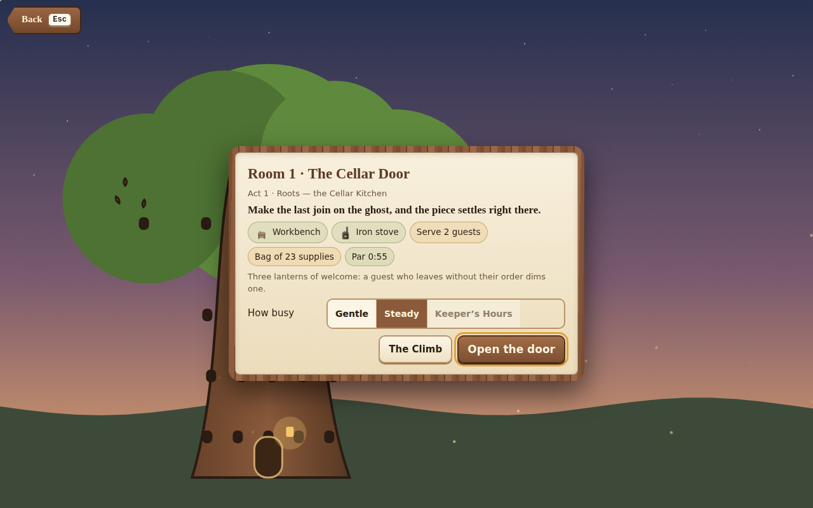
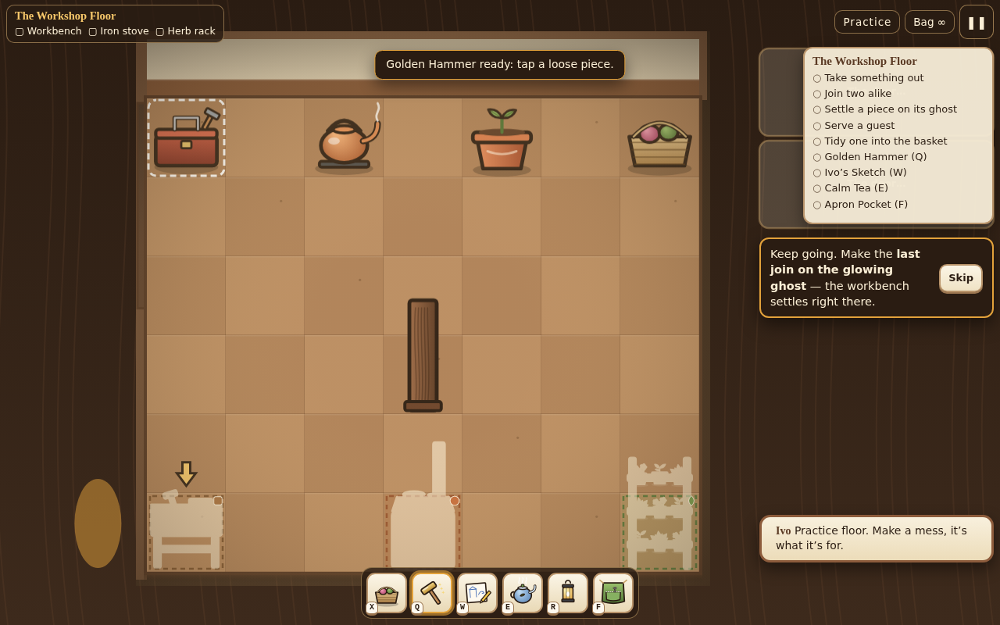
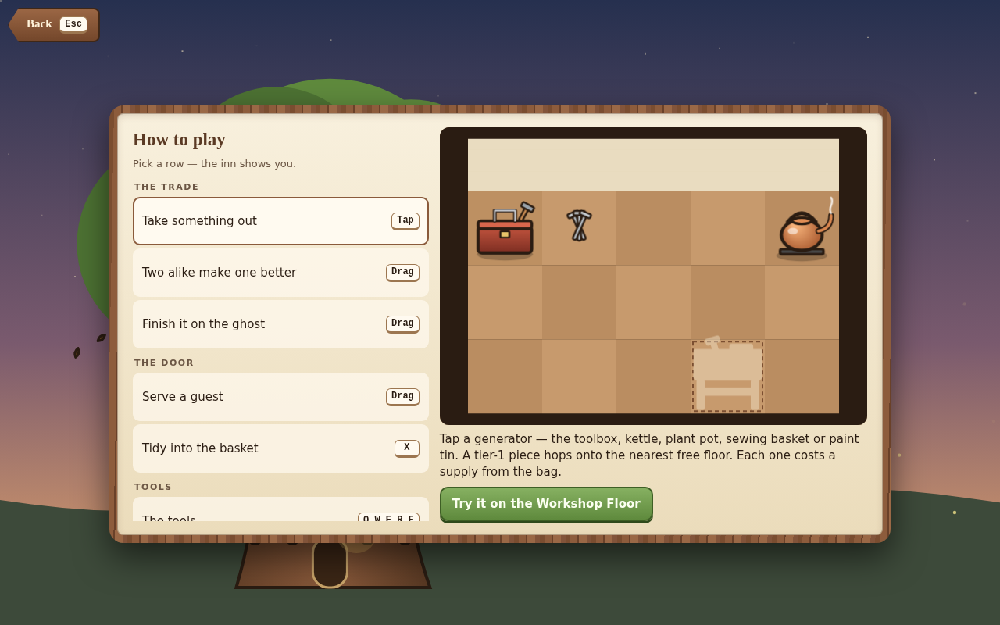

# Nestwood

**Merge bits into furniture on the floor itself: each finished piece stays where you made it, so you decorate a treehouse inn room by room.**

<p align="center">
  
</p>

<p align="center">
  <a href="https://ai-llm-2030.github.io/TrueMarch_Games_Nestwood/"><b>▶ Play Nestwood in your browser</b></a>
</p>

## Gameplay

<p align="center">
  
</p>

## More screenshots

<table>
<tr><td width="50%"><br><sub>The inn's twenty rooms</sub></td><td width="50%"><br><sub>A room brief</sub></td></tr>
<tr><td width="50%"><br><sub>The Workshop Floor</sub></td><td width="50%"><br><sub>How to play</sub></td></tr>
</table>

## Controls

| Keys | Action |
|---|---|
| Drag alike onto alike | Merge |
| ← → ↑ ↓ then Enter | Take / place |
| 1 – 4 | Serve a guest |
| X | Basket |
| Q W E R F | Tools on the Workshop Floor: hammer, sketch, tea, lantern, pocket |

## Run it yourself

No install, no build step, no server code, no network. The game runs entirely in your browser and keeps your progress in the browser's local storage.

```bash
git clone https://github.com/ai-llm-2030/TrueMarch_Games_Nestwood.git
cd TrueMarch_Games_Nestwood
python3 -m http.server 8000
# open http://localhost:8000
```

Opening `index.html` directly works too in most browsers; a local server is the most reliable way.

## What's inside

```
TrueMarch_Games_Nestwood/
├── index.html        the whole game: one file, plain JavaScript and <canvas>
├── assets/           the pictures in this README
├── LICENSE
└── README.md
```

Written from scratch in vanilla JavaScript: every sprite, background and sound is drawn or synthesised in code (Canvas 2D and the Web Audio API). No libraries, no frameworks, no third-party assets.

## About

**Nestwood** is one of the 120+ games made by **[TrueMarch](https://truemarch.com)**. This repository is the standalone single-player edition of the game.

## License

© 2026 TrueMarch. All rights reserved. The source is published so you can read it, learn from it and play the game; see [LICENSE](LICENSE).
